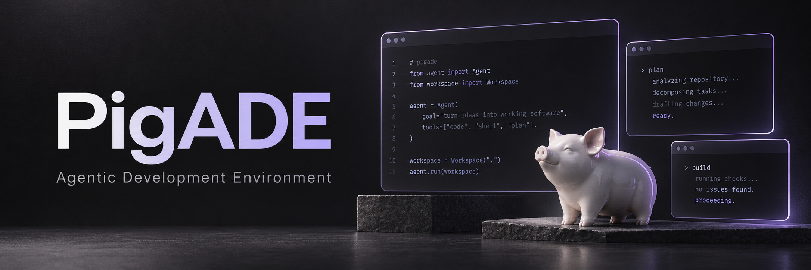

<p align="center">
  
</p>

<h1 align="center">PigADE</h1>
<p align="center"><strong>CLI-агенты. Один рабочий стол.</strong></p>
<p align="center">Claude Code · Codex · OpenCode · Shell</p>
<p align="center"><code>dev 0.0.1</code> · Linux · Rust + GPUI</p>

---

PigADE — настольная среда для работы с несколькими CLI-агентами в одном проекте. Откройте репозиторий, создайте воркспейс под задачу и разместите терминалы так, как удобно вам.

**Проект → Воркспейс → Вкладки → Терминальные панели**

## Что внутри

- **Настоящие терминалы.** Каждый агент работает в собственной CLI-сессии со своим интерфейсом и авторизацией.
- **Tiling.** Разделяйте, перемещайте и меняйте размеры панелей. Есть focus mode, undo/redo и перенос между вкладками и воркспейсами.
- **Работа по задачам.** Несколько проектов, общая папка или отдельный Git worktree для воркспейса.
- **Общий контекст.** Инструкции проекта, роли и версионированная память с явным выбором того, что передать агенту.
- **История и продолжение.** Просмотр сохранённого вывода и отдельных поколений сессии; подтверждаемое продолжение конкретного диалога средствами CLI.
- **Инструменты рядом.** Профили агентов, библиотека промптов, сохранённые раскладки и просмотр изменений Git со stage/unstage и коммитом.

## Попробовать

Пока это **экспериментальная Linux-версия**, без готового установщика. В `main` есть незавершённые изменения; для знакомства используйте последний проверенный срез `87f40c0`.

Нужны Rust/Cargo, C/C++ toolchain и системные зависимости GPUI. Проверенная среда — Linux x86_64, Rust 1.98.1. Подробности сборки — в [руководстве приложения](crates/app/README.md).

```sh
git clone https://github.com/PIG-Corp/PigADE.git
cd PigADE
git switch --detach 87f40c0

cargo build --locked --release --workspace --bins
crates/app/bootstrap.sh build --locked --release

./crates/app/target/release/pigade-app
```

Приложение само запускает локальный session host. Claude Code, Codex и OpenCode устанавливаются и авторизуются отдельно; доступные возможности и проверенные версии перечислены в [матрице CLI](docs/compatibility/CLI.md).

После сборки можно добавить PigADE в меню приложений, включая Quickshell:

```sh
python3 scripts/install-desktop.py
```

Ярлык использует последний собранный release-бинарник из этого репозитория.

## Первые пять минут

1. Нажмите **«Открыть папку»** для существующего Git-репозитория или **«Создать проект»** для новой папки.
2. Воркспейс **«Основной»** и первая вкладка появятся автоматически.
3. Откройте **«Терминал»** или выберите CLI через **«Добавить агента»**.
4. Соберите раскладку через меню панели, мышь или клавиатуру.
5. Для отдельной задачи создайте новый воркспейс; при необходимости выберите worktree.

Обычный запуск открывает CLI без передачи общего контекста. Роль, память и инструкции можно явно настроить через команды **«Настроить запуск…»** в палитре.

## Управление

| Действие | По умолчанию |
| --- | --- |
| Палитра команд | `Ctrl+Shift+Space`, затем `P` |
| Новый shell / новая вкладка | `Ctrl+Enter` / режим PigADE, затем `T` |
| Переместить панель | `Ctrl` + перетаскивание ЛКМ |
| Изменить размер панели | `Ctrl` + ПКМ или перетаскивание границы |
| Активная панель | Следует за курсором |
| Скопировать выделение | `Ctrl+Shift+C` |

Клавишу управления панелями можно изменить в настройках. Полный список действий — в [руководстве](docs/USAGE.md).

## Статус разработки

**dev 0.0.1 — ещё не MVP и не beta.** Терминальный фундамент и основные сценарии реализованы, но проверка платформ, доступности, производительности и полного восстановления ещё не завершена. Исторический вывод обозначается отдельно от живого процесса; прежний процесс после перезагрузки ОС не считается работающим.

Текущий `main` также содержит WIP порядка вкладок и исследовательские патчи. Известные проблемы и точка продолжения — в [handoff](docs/AGENT_HANDOFF.md). Обложка выше — иллюстрация, а не скриншот приложения.

## Документация

- [Руководство пользователя и команды](docs/USAGE.md)
- [Спецификация](SPEC.md) · [Дизайн](DESIGN.md) · [Архитектура](docs/PROJECT_MAP.md)
- [Совместимость CLI](docs/compatibility/CLI.md) · [Архитектурные решения](docs/adr/)
- [Изменения](CHANGELOG.md) · [Состояние разработки](docs/AGENT_HANDOFF.md)

Для изменений кода начните с [AGENTS.md](AGENTS.md). Лицензия проекта пока не выбрана; лицензии сторонних компонентов сохранены в репозитории.
