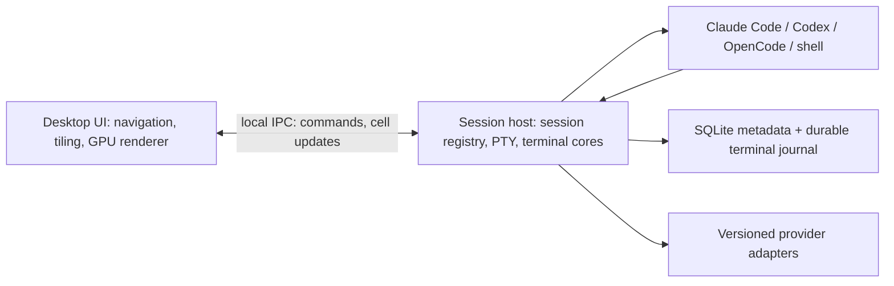

# PigADE — спецификация проекта

**Agentic Development Environment** — настольная среда для организации и параллельной работы CLI-агентов.

**Версия:** 0.4 (уточнения пользователя в ходе dev 0.0.1). **Дата:** 18.10.2026. **Статус:** проектная спецификация до реализации. Числа производительности ниже — критерии будущей приёмки, а не результаты измерений. Визуальный контракт: [DESIGN.md](DESIGN.md).

Термины требований: **обязательно** — условие приёмки; **целевое значение** — проверяемый бюджет; **после MVP** — отдельная очередь, не обязательство первой поставки. Основной технический стек предложен и окончательно фиксируется после прототипа из раздела 10.4.

## 1. Суть продукта и границы

PigADE объединяет Claude Code, Codex, OpenCode и другие agentic CLI в управляемую рабочую среду. Пользователь организует работу по проектам и воркспейсам, задаёт общий контекст и управляет несколькими терминалами через tiling manager. Каждый CLI сохраняет собственный интерфейс, команды, аккаунт и модель работы.

Главная ценность: разработчик открывает задачу и получает организованное рабочее место с нужными агентами, ролями, папками, историей и раскладкой; после возвращения ему не приходится собирать всё заново.

Приоритеты в порядке принятия решений:

1. Корректность терминального вывода и сохранность подтверждённого состояния.
2. Предсказуемое восстановление, без дублирования процессов и подмены диалога.
3. Удобное управление панелями с клавиатуры и мышью.
4. Низкая задержка, плавность и ограниченное потребление ресурсов.
5. Спокойный, аккуратный визуал в Apple style.

В первой версии PigADE — local-first desktop-приложение. Для запуска не нужны аккаунт PigADE, облако или собственный AI backend. CLI устанавливаются отдельно и используют привычную авторизацию. Офлайн доступны локальная навигация, история, контекст и shell; возможность работы самого AI зависит от его провайдера.

Не входит в MVP: IDE с собственным редактором и LSP, автоматическая координация команды агентов, облачная синхронизация, совместное редактирование, удалённые хосты, браузер/симулятор внутри приложения, голос, маркетплейс расширений. Они не должны усложнять основной терминальный контур.

## 2. Исходные решения и референсы

Пользовательские требования: иерархия «Проект → Воркспейс → экран с CLI-агентами», вкладки, общий промпт/роль/память, полноценный tiling, сохранение форматирования, восстановление после перезапуска приложения и ПК, высокая производительность, визуал в Apple style. Эти требования образуют ядро MVP.

Проектные допущения, которые можно изменить до реализации:

| Решение | Исходное значение | Почему |
| --- | --- | --- |
| Первая платформа | Linux x86_64, Wayland и X11 | Текущая рабочая среда; обе сессии проверяются отдельно |
| Обязательные целевые платформы | Linux x86_64, macOS Apple Silicon, Windows x64 | Уточнение пользователя: кроссплатформенный продукт с одинаковым поведением; Linux — первая среда проверки, другие ОС требуют собственных сборок и runtime tests |
| Формат проекта | Один общий Git-репозиторий, несколько именованных подпроектов | Соответствует требованию объединения частей продукта в общем репозитории |
| Git-изоляция | Отдельный worktree для нового рабочего воркспейса по умолчанию | Разные задачи не меняют одну checkout-папку одновременно |
| Язык UI | Русский; структура для английской локализации | Язык исходной задачи |
| Сохранение | Локальное, автоматическое; надёжный режим по умолчанию | Восстановление важнее минимальной экономии дисковых операций |

Источники проверены 16–17.10.2026. Референсы зафиксированы по конкретным источникам, а не по предположению об одинаковом поведении всех версий:

- BridgeMind Code Mode документирует рабочую папку, несколько панелей, split/stack/tab, изменение размеров и шаблоны запуска. PigADE использует этот принцип организации, сохраняя собственную модель проекта и контекста. [Официальный Code Mode](https://docs.bridgemind.ai/docs/code-mode).
- BridgeMind 0.3.3 описывает dock при drop на край и swap при drop в центр. Первоначальная семантика PigADE заменена по уточнению пользователя от18.10.2026 на Dwindle-перенос из раздела5.2; swap остаётся отдельной командой. [Release notes 0.3.3](https://www.bridgemind.ai/changelog/bridgemind-one/v0-3-3).
- BridgeMind 0.3.4 различает background terminal host, переподключение к живой сессии, воспроизведение истории и resume диалога. PigADE делает эти различия явным контрактом восстановления. [Release notes 0.3.4](https://www.bridgemind.ai/changelog/bridgemind-one/v0-3-4).
- Hyprland Dwindle — референс дерева размещения и операций с пропорциями split. В PigADE ориентация сохранённых splits стабильна и меняется только явной командой. [Dwindle documentation](https://wiki.hypr.land/configuring/layouts/dwindle-layout/).

Apple style здесь означает качество композиции, типографики и обратной связи. Копирование ассетов, брендинга и точных экранов BridgeMind не требуется. Платформенную поддержку PigADE проверять самостоятельно: официальные страницы BridgeMind могут описывать разные поколения продукта.

## 3. Модель данных и иерархия

### 3.1. Основные сущности

```text
Project
├── Repository identity + named roots: backend / client / packages / ...
├── Project context
└── Workspace [1..N]
    ├── Task + worktree/shared checkout + context + memory
    ├── AgentSession [0..N]
    └── Tab [1..N]
        └── LayoutTree
            ├── Split(axis, weights, children)
            └── Pane → AgentSession или shell session
```

**Проект** — продукт или группа связанных подпроектов в одном общем Git-репозитории. Хранит название, корневую папку, идентичность репозитория, именованные подпапки, общие инструкции и список воркспейсов. Например, проект объединяет `server/`, `android/` и `shared/`. Независимые Git-репозитории в одной группе — возможное последующее расширение; в MVP их нельзя изображать одним общим репозиторием.

**Воркспейс** — рабочий контекст задачи: агенты, общие инструкции, роль по умолчанию, память, worktree и вкладки. Пример: «Новая авторизация» с implementer, reviewer и терминалом тестов. Это не sandbox и не гарантия координации агентов.

**Вкладка** — отдельная сохранённая раскладка внутри воркспейса. Например, «Разработка», «Ревью», «Проверки». Переключение вкладки меняет видимость, не завершает процессы и не обнуляет размеры PTY скрытых панелей.

**Панель** — визуальное окно CLI с заголовком, состоянием и операциями размещения. «Экран агента» — рабочий canvas выбранной вкладки, а не ещё один обязательный уровень навигации.

**AgentSession** — логическая сессия конкретного CLI: provider, executable, cwd, роль, версия контекста, внешний conversation ID и политика восстановления. **ProcessGeneration** — отдельный запуск процесса внутри этой сессии. После reboot логическая сессия прежняя, PID, PTY и поколение процесса новые.

### 3.2. Идентичность и инварианты

Все сущности имеют стабильные UUID. Имя, позиция панели, PID и путь не используются как единственный идентификатор. Репозиторий сопоставляется по canonical path, Git common directory и сохранённому UUID проекта; исчезнувший путь требует явного перепривязывания. Remote URL — дополнительный признак, а не надёжная идентичность.

- Вкладка принадлежит одному воркспейсу, панель — одной вкладке. В MVP одна live-сессия имеет одну управляющую панель; зеркала возможны позднее.
- Перестановка панели не перезапускает CLI и не меняет conversation ID.
- Перенос внутри воркспейса сохраняет cwd и контекст сессии.
- Перенос между воркспейсами меняет размещение и владельца ссылки, но не изменяет cwd, worktree, права или контекст работающего процесса. При несовпадении UI показывает исходный worktree/контекст; для перехода на новые условия создаётся новая сессия.
- Закрытие окна приложения, скрытие панели, архивирование воркспейса и остановка CLI — разные операции.
- Схлопывание layout-узлов не удаляет историю сессии. Повторное открытие остановленной панели не запускает задачу автоматически.

Остановка CLI — отдельное явное действие с подтверждением для зафиксированных session/generation. Оно доступно для выбранной панели и скрытой сессии, сохраняет размещение и историю и не входит в undo раскладки. Закрытие подтверждения до отправки ничего не останавливает; после отправки закрытие sheet не отменяет запрос. Успешный ответ host означает приём запроса, а завершение показывается только после наблюдения `exited` того же поколения. При потере ответа UI читает состояние без повторной отправки Stop; история или degraded не считаются доказательством завершения. Текущее ограничение Unix-адаптера: сигнал получает основной процесс CLI; завершение всего дерева потомков пока не гарантировано и явно обозначено перед подтверждением.

## 4. Основные пользовательские сценарии

### 4.1. Создать рабочую среду

1. «Добавить проект» → выбрать локальную папку Git-репозитория, увидеть название, ветку и именованные корни.
2. «Создать воркспейс» → задача, отдельный worktree или существующая checkout-папка, общие инструкции и роль по умолчанию.
3. Выбрать пустую раскладку или шаблон: один агент; implementer + reviewer; два агента + shell; четыре панели. До запуска видны число процессов, cwd и роли.
4. Добавить CLI из обнаруженных или указать executable вручную. Нет обязательного AI-аккаунта PigADE.
5. Проверить итоговый контекст и запустить. Панели появляются в сохранённой раскладке; фокус получает выбранная панель.

Если worktree создать нельзя, сохраняется подготовленный воркспейс с объяснением ошибки. Приложение не подменяет его общей checkout-папкой незаметно.

### 4.2. Работать с несколькими агентами

Разработчик назначает Codex роль implementer, Claude Code роль reviewer, запускает тесты в shell. Общие соглашения берутся из воркспейса; индивидуальные задачи различаются. Нужная панель находится по имени, роли или статусу через command palette. Состояние «ждёт ответа» показывается только при достоверном сигнале адаптера; отсутствие вывода не считается доказательством ожидания.

Имя панели хранится отдельно от заголовка CLI: до128 символов/512 байт UTF-8, без управляющих символов; пустое значение возвращает автоматический заголовок. Сохранение использует ревизию имени и не меняет процесс, контекст или undo размещения. Поиск охватывает размещённые панели готовых воркспейсов всех проектов, имя/заголовок, провайдера, замороженную роль и известное состояние; результаты выдаются страницами до64 записей. Мышь и клавиатура используют один порядок результатов. Переход атомарно выбирает проект/воркспейс/вкладку и панель, сохраняя выбранное поколение; запуск CLI не выполняется. Ответы поиска привязаны к диалогу, запросу и ревизии поля. При конфликте перехода список обновляется явным действием, без автоматического повтора перехода.

### 4.3. Менять раскладку

Пользователь делит панель, меняет пропорции, перетаскивает заголовок, меняет панели местами, переносит их на другую вкладку и временно разворачивает одну панель. Завершение операции сохраняет новую раскладку. Обновление дерева не уничтожает терминальную модель и не создаёт новый PTY.

### 4.4. Вернуться после перезапуска

После запуска PigADE восстанавливаются выбранные проект/воркспейс/вкладка, дерево панелей, размеры, фокус, viewport и история. Живые процессы подключаются повторно. Утерянные процессы получают новую генерацию с native resume, если известен точный внешний ID и capability подтверждена. Исторический кадр до старта нового процесса доступен отдельно и не выдаётся за живой терминал.

### 4.5. Передать общую задачу

Редактор общего задания позволяет выбрать несколько сессий и предварительно увидеть текст и получателей. Отправка создаёт отдельные delivery records. Приложение не печатает текст вслепую в каждый PTY: агент мог находиться в меню, shell или запросе разрешения. Возможность автоматической доставки зависит от адаптера; у универсального CLI доступен подготовленный текст для явной вставки в выбранную панель.

## 5. Tiling manager

### 5.1. Структура и операции

Базовая модель — дерево splits с горизонтальной/вертикальной осью и нормализованными весами. Лист — панель. Вкладки находятся над деревом; произвольные вложенные tab-группы не требуются для MVP. Пустые контейнеры удаляются, контейнер с одним ребёнком схлопывается; ID живых панелей сохраняются.

Обязательные операции: split вправо/вниз и на любую сторону через drop; направленный focus; move; swap; resize; equalize; rotate split; временный focus mode; перенос между вкладками/воркспейсами; переименование; сохранение шаблона. Шаблон хранит геометрию и настройки запуска, а не PID и чужие conversation ID.

Новая панель делит выбранную область, исходная остаётся на месте. Изменение размера окна приложения меняет доступную геометрию, сохраняя дерево, порядок и веса. Не выполнять автоматическую смену оси из-за aspect ratio.

Плавающие терминальные окна внутри canvas и произвольный бесконечный canvas — после MVP. Focus mode и удобное управление splits обязательны уже в MVP.

Закрытие вкладки — отдельное подтверждаемое изменение каталога, не команда остановки CLI. Host сверяет ревизии вкладки, layout и выбора; атомарно удаляет вкладку, её viewport и все упоминания в снимках размещения, выбирая следующую либо предыдущую вкладку того же воркспейса. Последняя оставляет выбранный воркспейс без вкладки. Процессы, поколения, журналы, aliases и сохранённый выбор поколения остаются; панели доступны через «Сессии». Undo не восстанавливает закрытую вкладку; шаги размещения, ставшие пустыми после удаления её проекции, исключаются, остальные проходят проверку непрерывности. Активный configured template run блокирует закрытие своей вкладки до завершения/отмены. Конфликт или неизвестный результат требуют явной сверки перед новым подтверждением, автоматического retry нет. Capability `tab_close_schema=1` отделяет старый host без этой операции.

### 5.2. Мышь и перетаскивание

Активная панель следует за реальным движением курсора над её телом или заголовком без клика. Неподвижный курсор не отменяет клавиатурный focus. Выделение текста, захват кнопки CLI, drag/resize, диалог, активный IME preedit и неактивное окно блокируют hover focus. UI переключает адресат ввода сразу, сохраняет последнюю цель через ограниченную очередь: одна запись в полёте и один последний intent. Старый focus ACK не возвращает ввод к предыдущей панели.

Уточнение поведения Hyprland: модификатор+ЛКМ подхватывает панель сразу (`binds:drag_threshold=0` в исходном профиле); drag за заголовок сохраняет порог больше10px по евклидовой дистанции. Подхват — только preview: отпускание модификатор+ЛКМ без движения не меняет split/weights и историю undo/redo. Для недопустимой цели показываются текст отмены и отдельный контур; отпускание возвращает исходное размещение.

По уточнению пользователя от18.10.2026 перенос следует Hyprland Dwindle: drag за заголовок/handle либо выбранный модификатор+ЛКМ из тела панели. При модификаторе плавающий preview начинается на mouse-down; при захвате заголовка — после порога10px. Панель временно вынимается из дерева и отображается под курсором в85% исходного размера с сохранением относительной точки захвата (заголовок и край не прыгают в центр); остальные занимают освободившееся место. Это временное представление, не свободное размещение в сохранённом layout. CLI не получает управляющий жест. Во время preview не меняются durable layout и размеры PTY; терминальные клетки сохраняют размер без масштабирования.

При drop на панель создаётся sibling split: если целевая область шире высоты — горизонтальный, иначе вертикальный; половина области под курсором определяет сторону вставки. Цель — панель непосредственно под курсором; над зазорами внутри canvas выбирается ближайшая tiled-панель по расстоянию до её прямоугольника (при равенстве — стабильный UUID), без плавающего источника. Вне canvas перенос отменяется; подсветка показывает выбранную половину, отдельная миниатюра — итоговое дерево и переносимую панель. Миниатюра строится той же Move-командой и не участвует в hit testing, чтобы цель не колебалась между новыми половинами. Preview вычисляет геометрию синхронно, поэтому быстрый move/up до следующего кадра использует ту же цель. В focus mode preview временно показывает и запрашивает кадры остатка дерева без сохранения этого режима; после жеста polling снова ограничен видимой панелью; отмена возвращает точный режим и размещение, успешный Move сохраняет focus mode и новую раскладку. Геометрия сохраняет слот каждой сессии, включая скрытые панели, чтобы hit testing и resize не меняли адресат. Центр не означает swap; обмен доступен отдельной клавиатурной командой. Существующие splits не меняют ось автоматически. После durable commit действуют размеры итоговой раскладки. Escape, отпускание вне canvas и потеря фокуса отменяют незавершённый жест. Перенос во вкладки/воркспейсы остаётся доступен командами. Прямой drop на другую видимую вкладку текущего Ready-воркспейса подсвечивает её и показывает компактный предпросмотр будущей раскладки до отпускания. Пустая цель получает первую панель; непустая — sibling справа от своей выбранной панели. Preview не меняет выбор вкладки, дерево, процессы или PTY. Отпускание одной транзакцией переносит точную панель и выбирает вкладку назначения; host проверяет layout/selection revisions, исходную вкладку и точную цель, без fallback. Результат даёт один undo размещения; undo возвращает обе раскладки и сохраняет выбранную вкладку. Escape/выход из цели отменяют preview. Старый host без pane_tab_drop_schema=1 не предлагает эту цель; schema SQLite не меняется. Прямой drop между воркспейсами пока не реализован.

Модификатор+ПКМ меняет ближайшую видимую границу ancestor split.

Resize захватывается через расширенную область разделителя. Во время движения chrome следует за курсором; PTY получает целочисленные размеры не чаще согласованного cadence, а не на каждый raw pointer event. На mouse-up обязательно применяется финальный размер. Изменения `rows/cols` проходят через общий порядок событий с выводом PTY, см. раздел 7.

Double click разделителя выравнивает соседние области; команда доступна и через меню. При невозможном размере drag ограничивается минимальными размерами, а не создаёт нулевой PTY.

Перенос через Ctrl+Shift+1…9 или Ctrl+Shift+Space, M сохраняет текущую вкладку выбранной. В меню назначения ищите проект, воркспейс или вкладку, выбирайте стрелками и Enter; PgUp/PgDn листают страницы по64 результата, Ctrl+R явно обновляет каталог. Пустая цель получает панель первой, занятая — справа от своей выбранной панели. Архивные и недоступные воркспейсы исключены. Ошибка сохраняет запрос; процесс, его рабочая папка и замороженный контекст при переносе не меняются.

### 5.3. Клавиатура

По уточнению пользователя от18.10.2026 основной профиль — зажатый настраиваемый модификатор, по умолчанию Ctrl, со схемой управления как в его Hyprland. Выбор Ctrl/Alt/Super/Ctrl+Alt/«Только prefix» доступен из chrome и палитры; личная UI-настройка сохраняется атомарно в `${XDG_CONFIG_HOME:-$HOME/.config}/pigade/controls.json`, отдельно от данных проектов/host. Выбор применяется после подтверждения записи, ошибки видны. Системные bindings не изменяются; Super может перехватываться compositor.

Модификатор + Q закрывает размещение панели, сохраняя CLI в фоне; F переключает focus mode с точным возвратом; стрелки меняют фокус, Shift+стрелки меняют панели местами; 1…9 переключают вкладку, Shift+1…9 переносят панель; Tab/Shift+Tab переключают вкладки; Enter запускает shell; `;`/`'` меняют пропорции ближайшего горизонтального split. Автоповтор не повторяет закрытие, toggle или запуск. Sheet показывает занятые сочетания: в профиле Ctrl клавиши Ctrl+F/Q и Ctrl+стрелки отданы PigADE. Остальные сочетания, включая Ctrl+C/D/Z/R, передаются CLI. В полях и диалогах этот профиль не перехватывает редакторские команды; AltGr с prefer-character-input сохраняет ввод текста.

Локальный prefix `Ctrl+Shift+Space`, затем команда, остаётся доступен при любом выбранном модификаторе:

| После prefix | Операция |
| --- | --- |
| `H / J / K / L` | Фокус влево / вниз / вверх / вправо |
| `Shift+H/J/K/L` | Переместить панель в указанном направлении с dock |
| `W`, затем `H/J/K/L` | Поменять с соседней панелью местами |
| `V / S` | Разделить вправо / вниз |
| `R`, затем стрелки | Режим изменения пропорций; Enter завершает, Escape отменяет |
| `=` | Выровнять размеры соседних панелей |
| `F` | Включить / выключить focus mode |
| `1…9` | Выбрать вкладку |
| `T / P` | Создать вкладку / открыть палитру команд |
| `M` | Меню переноса на вкладку или в воркспейс |
| `D` | Библиотека сохранённых раскладок |
| `Z / Shift+Z` | Отменить / повторить изменение раскладки |
| `Escape` | Выйти из режима без изменений |

Prefix показывает подсказку на экране и не требует запоминания всех команд. Таймаут и способ передачи самого prefix в CLI настраиваются и проверяются. Не перехватывать обычные Ctrl+C, Ctrl+D, Escape и немодифицированные стрелки вне активного режима PigADE. Опасные действия не назначаются на короткую одиночную клавишу.

Направленный focus выбирает ближайшую видимую панель в соответствующей полуплоскости с приоритетом пересечения по другой оси; равенство разрешается стабильным порядком дерева. Wrap выключен по умолчанию. Mouse focus по уточнению пользователя от18.10.2026 следует реальному перемещению курсора над панелью; click-to-focus также доступен. Неподвижный курсор не отменяет клавиатурный фокус. Если pointer enter/motion пришёл до активации окна, сохранённое наведение применяется при активации без второго движения, только пока курсор внутри окна; одна клавиатурная активация не создаёт наведение.

### 5.4. Геометрия и отмена

Минимальная интерактивная панель — целевые 40 колонок × 8 строк терминала плюс chrome. Это предел layout, а не обещание удобства каждого CLI; адаптер может рекомендовать больше. Если всё дерево не помещается, показывается ограниченный scrollable canvas и предлагается focus mode. Сессии не уничтожаются и не получают размер 0×0.

Undo/redo хранит минимум 50 завершённых изменений раскладки. Оно отменяет геометрию, перестановки и переносы, но не введённые команды, остановку процесса, запись файлов или удаление worktree. Перенос между воркспейсами оформляется одной транзакцией. Закрытая панель может вернуться с сохранённой историей; завершённый процесс не «оживает» из-за Undo.

## 6. Общий промпт, роли и память

### 6.1. Состав контекста

Общий контекст — управляемый документ, а не скрытая рассылка клавиш:

```text
Project instructions
+ Workspace instructions and task
+ Workspace default role OR Agent role override
+ Selected workspace memory
+ Agent-specific instructions
= Effective context revision
```

Роль задаёт цель, обязанности, ожидаемые артефакты и ограничения. Исходные шаблоны: implementer, reviewer, researcher, tester и custom. Роль — инструкции, а не техническое ограничение доступа к инструментам. Права и sandbox задаются только средствами самого CLI или отдельным явно реализованным механизмом.

Текстовые блоки сохраняют источник и порядок; `Agent role override` заменяет именно выбранный шаблон роли, не остальные правила. Этот порядок сборки не меняет иерархию system/developer/user внутри внешнего CLI и не отменяет его политики или инструкции репозитория. UI показывает конфликтующие настройки и происхождение блоков, не обещая автоматическое разрешение смысловых противоречий.

### 6.2. Версии и применение

Каждое изменение создаёт неизменяемую ревизию контекста с hash, временем и источниками. Перед запуском доступен просмотр итогового текста и метода доставки. Сессия хранит `requested_revision`, `delivery_status` и, если есть подтверждение адаптера, `applied_revision`. Отсутствие подтверждения нельзя заменять отметкой «применено».

Изменение общего документа по умолчанию действует на новые сессии. Для текущих есть явное действие «Передать обновление» с выбранными получателями и текстовым diff. На resume используется сохранённая ревизия сессии; переход на новую — отдельное действие, учитывающее особенности провайдера. Контекст не отправляется повторно просто из-за открытия UI.

Не перезаписывать пользовательские `AGENTS.md`, `CLAUDE.md`, глобальные конфиги и provider home directories. Использовать поддерживаемый session-scoped механизм адаптера. Сгенерированные вспомогательные файлы находятся в каталоге PigADE с ограниченными правами; их жизненный цикл принадлежит конкретной сессии.

### 6.3. Память воркспейса

Память — читаемый и редактируемый Markdown-документ воркспейса с секциями «Факты», «Решения», «Соглашения», «Что осталось». Записи имеют источник/автора и ревизию. Включение в контекст явное; лимит исходного выбранного текста — 32 KiB UTF-8, с предварительным просмотром. При превышении пользователь выбирает секции; молчаливое обрезание запрещено. Оценка токенов помечается приблизительной и зависит от провайдера.

Агенты могут предлагать обновления памяти как patch; общая память меняется после явного применения пользователем. Автоматическая генерация памяти и отдельный MCP-интерфейс — после MVP. Параллельные изменения используют compare-and-swap по revision; потерянные обновления не допускаются. Сырые CLI-транскрипты не становятся общей памятью автоматически.

## 7. Терминал и сохранение форматирования

### 7.1. Проверяемая гарантия

Терминал — критическое ядро продукта. Недопустимы пропавшие строки, рассыпавшиеся рамки, смешение поколений вывода, сломанный курсор, неверные цвета и обрезанные крайние клетки в поддерживаемой матрице CLI/версий/платформ.

Гарантия формулируется точно: при одинаковых размерах сетки, терминальном профиле и последовательности событий восстановленная модель совпадает с исходной; при resize применяется согласованная политика reflow и реальный CLI получает корректный размер. Произвольный CLI может сам неверно перерисовываться или использовать неподдерживаемый протокол. Такое поведение фиксируется как несовместимость; PigADE не объявляет его исправленным и не маскирует удалением истории.

### 7.2. Обязательная совместимость

Обязательны UTF-8, кириллица, box drawing, ANSI/VT cursor control, SGR и true color, normal/alternate screen, scrolling regions, tabstops, bracketed paste, корректные mouse reporting modes, выделение/копирование, поиск по истории, clipboard и IME. OSC 8 hyperlinks поддерживаются с безопасным открытием. Конкретные keyboard extensions объявляются только после проверки; неизвестные escape sequences не исполняются как команды хоста.

Тестовый корпус включает combining marks, CJK wide characters, emoji и ZWJ-последовательности, вариационные селекторы, CR/progress output, clear-screen, redraw после SIGWINCH, chunks, разрезающие UTF-8 и escape sequence. Поддержка Unicode определяется зафиксированной версией core, width tables и шрифтов; одного лозунга «поддерживает emoji» недостаточно.

Изображения Sixel/Kitty graphics и полная совместимость со всеми terminal extensions вне обязательного MVP. Не рекламировать `TERM`/terminfo-возможности, которых фактически нет. Базовый совместимый профиль и значения `TERM`/`COLORTERM` фиксируются в gate для каждой ОС.

Ручная вставка и file drop: нативный список путей из ОС адресуется панели под drop, включая её заголовок. До отправки показываются точный текст, сессия и поколение; Ctrl+Enter/явная кнопка подтверждают, Escape отменяет, обычный Enter ничего не отправляет. POSIX quoting поддерживает пробелы, апострофы и metacharacters; 1–32 абсолютных UTF-8 пути без управляющих символов, суммарный ввод не более16KiB с учётом bracketed framing. Неподдерживаемые имена отклоняются, не преобразуются с потерями. Приложение не читает файлы, не проверяет существование, не загружает вложения и не меняет cwd CLI. Нативные clipboard file entries используют тот же путь без конкатенации display-строк. Другие shell dialects и image bytes требуют отдельных адаптеров.

Любая вставка текста с CR/LF сначала открывает такой же readonly preview, поскольку для обычного терминала LF преобразуется в CR и может выполнять команды. Однострочный текст вставляется прежним явным clipboard действием. Confirm повторно проверяет точный live session/generation, отсутствие ошибок/неопределённого ввода и неизменность bracketed-paste режима; смена режима требует нового preview. Приложение не дописывает Enter. Нормализация CRLF/CR и bracketed markers соответствуют существующему encoder; clipboard contents не сохраняются как metadata. До явного подтверждения input не отправляется. Один Confirm допускает одну bounded команду; повтор при неизвестном исходе не выполняется, ошибки остаются в существующем generation-bound worker gate. QueueFull оставляет preview для нового явного действия; принятый локально ввод не объявляется применением модели/CLI.

### 7.3. Сетка, шрифты и resize

Размер терминального шрифта задаётся локальной revisioned-настройкой `terminal_font_size`: целое10–24 logical px, по умолчанию14. Старый файл schema1 без этого поля читается как14; недопустимое значение отклоняется, а не применяется частично. Мышь/клавиши в «Внешнем виде» и команды палитры меняют размер после подтверждённого сохранения; на границе диапазона и при сбросе уже установленного значения запись не создаётся. Размер chrome и ANSI-палитра независимы. Метрики, glyph shaping и IME используют один размер; rows/cols меняются обычным упорядоченным resize без нового процесса или изменения split-дерева. Незавершённые жесты со старой геометрией отменяются при применении нового размера. Перенос строк может измениться; это не обещание идентичного экранного кадра после resize.

Ширина/высота viewport вычисляются после вычитания chrome, padding и scrollbar. `cols=floor(usable_device_width/cell_device_width)`, аналогично `rows`; метрики и правила округления едины у renderer и PTY. Оставшиеся пиксели относятся к padding, а не обрезают клетку. Вычисление выполняется с учётом fractional scale и реальных font metrics.

Текст остаётся в моноширинной сетке; fallback, wide glyphs и combining marks не меняют соседние колонки. Не использовать визуальное масштабирование всего терминального слоя вместо изменения font metrics. Масштаб UI и размер терминального шрифта регулируются независимо.

Изменение layout создаёт `ResizeRequested`; session host сериализует применение размера PTY и модели с `Output` в одном потоке событий, фиксирует `ResizeApplied` и сообщает новую geometry revision. UI до подтверждения может клиповать поверхность, но не растягивает старый кадр. Невозможно восстановить внутреннее планирование внешнего процесса; журнал сохраняет фактически наблюдённый порядок событий host.

Normal screen использует проверенный reflow core с сохранением soft-wrap metadata. Alternate screen обрабатывается как экран приложения по правилам выбранного core; произвольный текстовый reflow поверх TUI запрещён. Изменение ширины закономерно меняет переносы; сохранность форматирования не означает одинаковые переносы при разных `cols`.

### 7.4. Терминальный pipeline

```text
PTY output / resize / mode timer event
        ↓
Single ordered session event stream
        ↓
Durable journal → authoritative terminal core
        ↓
Versioned cell updates / snapshots
        ↓
UI render replica → GPU renderer
```

Единственная authoritative модель и парсер находятся в session host. UI хранит только отображаемую реплику; второй ANSI-парсер в UI не должен интерпретировать тот же поток независимо. Каждый update относится к session UUID, generation и sequence. При пропуске sequence UI запрашивает согласованный снимок и tail, а не применяет дельты к неизвестному состоянию.

Скрытые панели продолжают получать и разбирать вывод, сохранять журнал и отвечать на terminal queries. Для них отключается постоянная отрисовка; при показе передаётся актуальный кадр. Копирование и поиск используют модель клеток/истории и soft-wrap, не OCR и не stripped ANSI log.

Очереди ограничены; при перегрузке применяется PTY backpressure и пакетная обработка. Нельзя отбрасывать raw output ради FPS. Можно объединять render notifications и передавать свежий полный кадр, сохраняя все события терминальной модели. Один шумный процесс не блокирует ввод остальных сессий.

## 8. Сохранение и восстановление

### 8.1. Четыре уровня состояния

| Уровень | Что сохраняется | Что происходит при возврате |
| --- | --- | --- |
| Рабочая среда | Проекты, воркспейсы, вкладки, дерево, веса, выбранная панель, размеры окна, viewport, контекст | Восстанавливается независимо от доступности CLI |
| Состояние отображения | Клетки, история, курсор, режимы, размеры и последовательность событий | Восстанавливается как терминальная модель/история |
| Живой процесс | PTY, PID, текущая работа CLI | Повторное подключение возможно, пока session host и ОС продолжают работать |
| Диалог провайдера | Внешний conversation ID и хранимая самим CLI история | Новый процесс использует native resume при подтверждённой capability |

После перезагрузки ОС прежние локальные процессы не сохраняются. PigADE автоматически возвращает рабочую среду и сохранённый терминал; продолжение диалога выполняется новым процессом. Продолжение вычисления с той же инструкции CPU, восстановление in-flight network requests и файлов, которые внешний процесс не успел записать, не гарантируются.

### 8.2. Сценарии отказа

| Событие | Ожидаемое поведение |
| --- | --- |
| Закрытие/сбой UI | Session host продолжает работу; новый UI подключается к тем же поколениям и актуальному кадру |
| Переключение вкладки/воркспейса | Процессы и обработка вывода продолжаются |
| Сон/пробуждение | Проверка живого host и сессий; переустановка UI-соединения, без дублирующего запуска |
| Сбой session host | Сохранённое состояние восстанавливается; выживание дочерних процессов не предполагается; orphan проверяется перед restart |
| Reboot / завершение пользовательской OS-сессии | Layout/история восстанавливаются; auto-resume по политике CLI, без автоповтора последнего задания |
| CLI/account/cwd недоступны | Панель и история остаются; причина и действие для исправления |
| Монитор отключён | Окно возвращается на доступный экран, дерево и веса остаются |
| Нехватка места/ошибка записи | Состояние storage degraded; последние durable данные защищены; фиктивного «Сохранено» нет |

На Linux host запускается как управляемый user service либо независимый user-процесс с доказанной защитой от завершения вместе с UI. Реализация проверяет cgroups и сигналы, не полагается только на `nohup`. Поддержка работы после logout — отдельная настройка ОС и вне гарантии MVP; closing UI и logout различаются.

### 8.3. Что именно хранится

Для каждой генерации сохраняются исходная геометрия, raw output bytes, строго упорядоченные применённые resizes, события настроек core и timer-события, влияющие на synchronized output; версия core/schema, Unicode width profile и font profile. Отдельно — terminal checkpoints, если их полнота доказана, и индекс истории. Внешний ID диалога, cwd, executable/version, context revision и recovery policy хранятся как метаданные логической сессии.

Полный checkpoint включает normal/alternate grids, горячий scrollback и ссылки на неизменяемую холодную историю с soft-wrap metadata, курсор и saved cursor, attrs/colors, modes, tabstops, scroll region, title stacks, keyboard modes и состояние парсера/частичного UTF-8/synchronized update. Сериализация только видимых строк, скриншот, текстовый лог или ANSI export не являются полным checkpoint.

**Эталон корректности — replay всего журнала поколения** с начальными настройками и событиями. Ускоренный путь `checkpoint + tail` допустим только при доказанном равенстве эталону. На раннем прототипе разрешён полный replay; для окончательной фиксации стека обязателен доказанный checkpoint/compaction либо эквивалентный механизм с ограниченной стоимостью восстановления. Полный replay остаётся эталоном и аварийным fallback с явным прогрессом, но не единственным production-путём для неограниченно долгих сессий.

Исходный checkpoint cadence — после 5 s изменяющего состояние вывода или 16 MiB новых событий, что наступит раньше; конкретные значения уточняются по benchmark. При backlog checkpoint writer применяется backpressure, чтобы хвост не рос бесконтрольно. Горячая история ограничена, холодная индексируется отдельно; восстановление рабочего кадра не требует чтения всего архива. Обязательный long-history corpus и его budgets указаны в разделе 12.2.

Replay выполняется в изолированной модели без отправки terminal responses в живой PTY, повторного clipboard, открытий URL, bell и других внешних эффектов. Восстановление модели не означает повторный запуск shell-команд или ввод сохранённого пользовательского текста.

### 8.4. Долговечность и запись

У каждого события есть монотонный sequence, тип, длина и checksum. Сегменты журнала append-only. Подтверждённые изменения layout/context записываются транзакционно; во время drag промежуточные позиции не считаются сохранённой операцией, финальный drop/resize становится завершённым после durable commit.

По умолчанию используется **durable-before-display** для терминала: batch событий записывается и синхронизируется на диск до публикации соответствующих cell updates в UI. Целевое окно group commit — до 8 ms на эталонном NVMe; фактическую задержку проверяет benchmark. `durable_seq` обозначает последнюю подтверждённую границу. UI не показывает неподтверждённый терминальный хвост как сохранённый. Вывод, ещё не полученный/зафиксированный host, может быть потерян при внезапном отключении питания.

Файлы и БД согласуются так: сначала durable journal/snapshot, затем DB transaction со ссылкой на offset/checksum. После сбоя сканируются валидные незарегистрированные сегменты; незавершённый хвост изолируется, не применяется как целое событие. Снимок публикуется через temporary file, fsync, atomic rename и синхронизацию каталога либо эквивалентную платформенную операцию. Поведение зависит от гарантий файловой системы/носителя; аппаратную поломку или обман `fsync` программно исключить нельзя.

При ошибке записи host сохраняет bounded pending buffer и применяет backpressure. UI остаётся отзывчивым, сообщает причину и позволяет освободить место/сменить storage location. Не молча продолжать бесконечную запись в RAM и не выбрасывать старые события. Опциональный быстрый режим с возможной потерей хвоста может рассматриваться позднее; он не подменяет надёжный default.

### 8.5. Протокол открытия и resume

1. UI соединяется с host, согласует protocol/schema version и проверяет принадлежность user/session.
2. Получает manifest проектов, вкладок, сессий и сохранённое расположение.
3. Проверяет доступность cwd/worktree и определяет поколение каждого процесса. PID без start identity/boot identity недостаточен.
4. Существующий процесс получает live reattach с согласованным snapshot + tail; race между snapshot и tail закрывается sequence watermark.
5. Для завершённого процесса восстанавливается исторический кадр. При разрешённом auto-resume адаптер проверяет внешний conversation ID, executable/version и профиль авторизации без копирования credential-файлов.
6. Новый процесс запускается с точным ID и сохранённым cwd через durable launch protocol ниже; operation ID и generation lock защищают также повторные IPC-команды.
7. Новый live terminal generation начинается со свежего состояния и вывода CLI. Предыдущая история остаётся отдельным сегментом; нельзя залить старый alternate screen в новую TUI и получить смешанный экран.
8. При ошибке resume остаётся явный `Resume failed`; «Начать новую беседу» — отдельное действие. Автоматическая подмена новой беседой запрещена.

Запуск проходит состояния `intent committed → helper registered → exec permitted → running`. До создания процесса host сохраняет launch intent с generation, operation ID и случайным launch nonce. Минимальный startup helper до `exec` ожидает разрешения; host сначала сохраняет проверяемую OS identity helper (на Linux boot ID + PID + process start time) и принадлежность generation. Только затем разрешается `exec`, сохраняющий process identity. При потере канала до разрешения helper завершает работу без запуска CLI. Платформенные реализации обязаны доказать аналогичную границу.

После сбоя незавершённый intent сверяется с OS identity и handshake, а при внешнем provider daemon — также с доступными provider receipts. В состоянии `launch outcome unknown` новый запуск запрещён до разрешения неопределённости; простое отсутствие PID в registry не считается доказательством завершения. Нельзя обещать exactly-once внешних действий провайдера без его поддержки идемпотентности. Протокол гарантирует отсутствие автоматического повторного запуска при неизвестном исходе, а не возможность угадать результат.

Если экран при возврате уже другого размера, исторический кадр сначала доступен в сохранённой сетке с fit viewport/прокруткой без масштабирования текста. Затем live-процессу отправляется один финальный согласованный resize. История не форматируется заново произвольным HTML/Markdown renderer.

Политики: `reattach-only`, `resume-when-supported`, `manual`. Default для сертифицированного AI CLI — `resume-when-supported`; это запускает native conversation resume без повторной отправки task prompt. Встроенное поведение самого CLI после resume проверяется адаптером. Обычный shell после reboot показывает прежнюю историю и действие «Открыть новый shell»; произвольный foreground command автоматически не перезапускается.

## 9. Интеграция CLI и Git

### 9.1. Контракт адаптера

Адаптер — версионированный модуль с manifest, поддерживаемыми версиями и capability flags:

```text
detect executable/version
build_launch_spec(argv, cwd, environment_delta)
prepare_context(context_revision)
bind_external_conversation_id / resume_by_id
observe documented status events (optional)
deliver_message with receipt (optional)
stop / inspect_recovery_failure
```

Для каждой capability допустимы `supported`, `unsupported`, `unknown`; неизвестное не считается работающим. Адаптер возвращает структурированный argv и environment delta, не строку для `sh -c`. Пользовательский shell command запускается только в явно выбранном shell-режиме.

Обнаружение читает разрешённый PATH/login-shell environment один раз с ограничением времени и кэшем; не загружает shell-конфиги на каждый кадр/панель. В UI видны executable, версия и источник настроек. Пакеты агентов, авторизация и платные подписки не входят в PigADE.

Реализованная библиотека профилей запуска (schema13; исходная библиотека schema11) хранит название, провайдера, роль, дополнительные инструкции, запрос доставки контекста и необязательные модель/reasoning effort, без runtime/conversation/cwd/auth/memory snapshots. Подготовка из профиля проверяет его текущую revision и фиксирует отдельный launch plan с ID/названием/revision источника; последующее изменение/удаление библиотечной настройки не меняет этот снимок или процесс. Профиль не является владельцем CLI: удаление настройки подтверждается отдельно с явным сохранением уже запущенных панелей. Provider availability и поддержка контекста проверяются перед запуском; профиль не вводит фиктивные разрешения или доступ к моделям. Непустые engine options требуют точной версии CLI и capability: Claude2.1.259 — --model/--effort, Codex0.162.1 — --model/разовая model_reasoning_effort, OpenCode1.19.3 — --model provider/model без effort. UI требует engine_options_schema=1; старые/future capability не принимаются. Поля и точный argv входят в неизменяемый plan; проверка перед launch отклоняет расхождение. Пустые поля оставляют native defaults. Native resume не повторяет исходные параметры модели: CLI владеет текущими настройками диалога. Это транспорт, а не подтверждение наличия модели, совместимости или применения. Схема13 сохраняет backup до миграции и защищена от старого writer. Расширенные agent chat/profile runtime/permissions из ориентиров BridgeMind не заявлены реализованными этой библиотекой.

Дополнение по пользовательскому разбору BridgeMind: библиотека `Prompt {id,title,content,revision}` хранит до128 активных текстов до32КиБ с CAS-сохранением. Удаление подтверждается и идемпотентно для той же исходной ревизии; компактный tombstone запрещает повторное использование UUID (до4096 записей всего). Схема12 сохраняет резервную копию до миграции. Выбор вставляет текст в зафиксированный product draft с его selection/undo либо явно копирует для ручной вставки; PTY не получает ввод, Enter и задачи не отправляются. Поздние ответы и конфликт не уничтожают черновик; изменения библиотеки не переписывают уже вставленный текст. История native CLI и автоматическая доставка не подменяются этой библиотекой.

### 9.2. Первая матрица провайдеров

| Провайдер | Обязательная базовая поддержка | Продолжение диалога | Контекст |
| --- | --- | --- | --- |
| Claude Code | Настоящий интерактивный CLI в PTY | Native resume конкретного ID; версионная проверка | Поддерживаемое session-scoped добавление инструкций, без замены штатного prompt по умолчанию |
| Codex | Настоящий интерактивный CLI в PTY | `codex resume <SESSION_ID>` после проверки версии/привязки | Поддерживаемая session-scoped настройка или подготовленный initial context; способ фиксируется в adapter tests |
| OpenCode | Настоящий интерактивный CLI в PTY | Native выбор конкретной сессии по ID | Конфигурация роли/агента и prompt по документированному механизму |
| Custom CLI / shell | Executable, argv, cwd, environment | Только если установлен соответствующий адаптер | Явная вставка/подготовленный текст; автоматическое применение не предполагается |

Официальная документация подтверждает resume-by-ID у [Codex](https://learn.chatgpt.com/docs/developer-commands#codex-resume), [Claude Code](https://code.claude.com/docs/en/cli-reference) и [OpenCode](https://opencode.ai/docs/cli/). Возможности роли и custom prompt OpenCode описаны в [Agents](https://opencode.ai/docs/agents/). Доступность флага сама по себе не доказывает получение conversation ID или полноту восстановления.

Адаптер обязан получить точный ID через поддерживаемое structured event/hook/API или явную привязку пользователем. Запуск `--last` при нескольких панелях недопустим: он может выбрать чужой диалог. Если надёжной автоматической привязки нет, показывается `Требуется выбрать диалог`, а не «автовосстановление работает». Нельзя строить обязательную совместимость на чтении приватных provider databases или regex по цветному экрану.

До beta для всех трёх встроенных адаптеров должна быть заполнена version matrix с запуском, контекстом и точным resume либо явно обозначенной ручной привязкой. Для заявления об автоматическом resume конкретной версии требуется автоматическая надёжная привязка. Минимальное покрытие — текущая зафиксированная версия и предыдущая поддерживаемая версия каждого CLI; при неизвестной версии доступен generic PTY с предупреждением о непроверенных дополнительных функциях.

Статус процесса (`starting/running/exited/failed`) отделён от семантического статуса агента (`working/awaiting input/unknown`). Семантика приходит из документированных событий; эвристика по тишине не может выдавать «готово» или «требует подтверждения». Native TUI остаётся источником интерактивных permission prompts; PigADE не подтверждает их автоматически.

Рассылка общего задания использует отдельный delivery ID на получателя. После reconnect неподтверждённая доставка имеет статус `unknown`; автоматический повтор запрещён без поддержки идемпотентности внешним API. Для CLI без надёжной доставки shared prompt означает одинаковые начальные инструкции и ручной перенос задачи, а не гарантированную автоматическую рассылку.

Текущая реализация (0.0.1-dev): ручной exact-ID resume включён для Codex0.162.1 и OpenCode1.19.3. OpenCode использует `--session ID` без prompt/context и публичный metadata preflight при подготовке и подтверждении: stored directory должна совпадать с исходной, workspace routing отклоняется. Проверка выполняется вне командного actor; завершение повторно сверяет binding/head/executable и identity папки. Автоматическая привязка/auto-resume, Claude resume и полная двухверсионная сертификация остаются открытыми; [матрица](docs/compatibility/CLI.md) перечисляет конкретные доказательства и ограничения.

### 9.3. Git и рабочие папки

Новый воркспейс предлагает отдельный worktree/branch; общая checkout-папка доступна как явный режим. Все агенты воркспейса могут работать в одном worktree и разных именованных подпапках. Это позволяет совместную работу, но не предотвращает конфликтующие одновременные изменения файлов. Для изоляции агенту можно создать отдельный воркспейс.

Git status, branch, worktree path и dirty indicator видны без постоянного полного сканирования дерева. Git CLI — первоначальный backend; команды выполняются асинхронно, cwd и argv явно заданы. File watchers исключают тяжёлые ignored/cache каталоги, используют debounce и bounded queue. Работа с большим монорепозиторием не блокирует терминал.

Реализованный первый срез: явный read-only снимок через кнопку Git/палитру, без периодического полного сканирования и без действий над файлами. Запрос фиксирует workspace UUID/revision; результат дополнительно сверяется с project/cwd и актуальным диалогом. Отдельные ограниченные очереди UI и host изолируют чтение от терминального ввода и записи раскладки. Porcelain v2 с NUL-разделителями сохраняет необычные имена; управляющие символы экранируются при показе. Ограничения времени/вывода/числа записей дают неполный результат с неизвестной чистотой. Watcher/debounce и постоянный автоматически актуализируемый индикатор остаются следующим срезом, данный снимок их не подменяет.

Просмотр файла открывает ограниченный diff выбранной стороны: HEAD→index, index→worktree или пустой→untracked. Host выводит cwd из Ready-воркспейса, повторно проверяет Git identity, точное членство path/side в status и неизменность входов. Относительные UTF-8 пути без traversal и чтение regular files без следования symlink; max256КиБ на вход, max128КиБ/2000 строк на ответ, явные binary/truncated/error. Приватный no-index diff отключает внешние diff/textconv drivers и не читает содержимое через пользовательский driver. Конфликтный worktree показывается отдельно как текст, не merge-интерфейс. UI связывает ответ с dialog/workspace/revision/project/cwd/path/side, хранит один in-flight и один последний ожидающий read-only запрос; закрытый/заменённый просмотр не открывается от позднего ответа.

Реализован ограниченный per-file Stage/Unstage по билету, выданному только для соответствующего поддерживаемого diff: Ctrl+S применяет его. Перед изменением повторно сверяются точные HEAD/ветка, identity репозитория, индекс, status/path/side и отображённое содержимое. Операция строит частный candidate index (index до8МиБ; выбранный файл до256КиБ), затем использует нативный `index.lock` и CAS-проверки до атомарной замены. Изменение рабочей копии запрещено. Явный Stage может запустить штатные Git clean/EOL filters. Нет автоматического повторного применения; состояние результата показывается как Applied/Rejected/Unknown/Unavailable. Ctrl+R проверяет неизвестный исход или обновляет снимок, Ctrl+Shift+R явно подтверждает просмотр Unknown/Unavailable. Билеты ограничены8 активными на10 минут; до4096 durable receipts сохраняют результат при закрытии диалога и перезапуске host. Sparse/split index, symlink и конфликтные записи недоступны. Этот срез не реализует discard/pull/push, Stage All или watcher и не закрывает Git MVP.

Создание обычного коммита реализовано отдельным frozen review: кнопка «Создать коммит» или Ctrl+Enter в списке Git, сообщение и повторный Ctrl+Enter для подтверждения. Билет связывает workspace/project/cwd, repository identity, локальную ветку, HEAD и точный индекс; перед native Git commit выполняется повторная проверка. Штатные hooks и подпись сохраняются; reference-transaction guard проверяет old HEAD, tree и parents, отдельное durable committed proof подтверждает публикацию. Неопределённый исход не запускает Git повторно; inspect и явный acknowledge сохраняют Unknown без доказательства. Результаты сохраняются при закрытии UI/host, черновик сообщения — только в текущем UI. Реализованная совместимость: Linux, Git2.55.0 ELF, attached local/unborn branch; без merge/rebase/sequencer, sparse/split index или конфликтов. До2 preview leases по10 минут, индекс8МиБ,512 путей,8192 байта UTF-8 сообщения,4096 receipts,120 секунд native Git. Старый host не перезапускается автоматически: capability commit_schema=1 включает действие. Amend/commit-all/remotes и interactive signing/credential prompts остаются вне этого среза. [ADR0015](docs/adr/0015-guarded-native-git-commit.md) фиксирует механизм и ограничения.

Удаление вкладки/панели не удаляет branch/worktree. Архивирование воркспейса сохраняет историю и по умолчанию не останавливает процессы. Отдельное «Остановить и архивировать» явно сообщает эффект. Удаление worktree требует проверки dirty/untracked файлов и отдельного действия пользователя; без автоматического `reset --hard`, `clean` или принудительного удаления.

### 9.4. Порядок именованных профилей

Порядок и закрепления профилей — отдельные метаданные реестра, не настройки запуска или placement. Host хранит schema1 roster с собственной revision, точной перестановкой текущих profile IDs и уникальным подмножеством закреплений (до128 профилей). Запись использует CAS; чужие, пропущенные и повторные IDs отклоняются атомарно. Создание/удаление профиля обновляет реестр в той же транзакции; редактирование содержимого не меняет его revision. SQLite schema14 сохраняет durable backup прежней схемы и переносит существующий rowid-порядок без закреплений. UI показывает сначала закреплённые записи, затем остальные, сохраняя канонический порядок внутри групп; Ctrl+P закрепляет, Alt+↑/↓ перемещает внутри группы. Выбор хранится по ID. Ответ после закрытия/замены диалога не открывает его заново; конфликт требует явного чтения, без автоматической повторной записи. Отсутствие agent_profile_roster у старого host отключает действия, не перезапуская host.

## 10. Техническая архитектура

### 10.1. Основной кандидат стека

| Область | Предлагаемая технология | Условие выбора |
| --- | --- | --- |
| Язык и concurrency | Rust stable + Tokio там, где нужен async I/O | Стабильный toolchain, отсутствие blocking I/O в UI |
| Desktop UI | GPUI из фиксированного проверенного upstream commit | Linux Wayland/X11, input/IME/accessibility и performance gate |
| Terminal core | `alacritty_terminal` | VT/Unicode correctness и доказуемый recovery path |
| PTY | `portable-pty`, один backend без лишних слоёв multiplexer | Spawn/resize/signals/teardown на целевой ОС |
| Terminal renderer | Собственный интеграционный слой поверх core и GPU GPUI | Готовая библиотека core не равна готовому виджету |
| Метаданные | SQLite, один writer, WAL и full synchronous для durable commits | Транзакции, backup/migrations и crash tests |
| История | Собственные append-only binary segments + checksums; сжатие закрытых сегментов | Последовательный I/O, ограниченные ресурсы, проверяемое replay |
| UI ↔ host | Versioned local IPC: Unix domain socket / Windows named pipe | Ограниченные сообщения, backpressure, user-bound endpoint |
| Конфиги/контекст | Версионированные локальные структуры + экспортируемый Markdown | Читаемость и переносимость без runtime-данных в репозитории |

GPUI — GPU UI framework; текущий upstream и опубликованные версии различаются, API до 1.0 нестабилен. Для PigADE нужен собственный pin и адаптерный слой вокруг UI framework. Поддержка платформ объявляется по проверенной сборке, а не автоматически наследуется от upstream. [GPUI upstream](https://github.com/zed-industries/zed/blob/main/crates/gpui/README.md), [published crate](https://docs.rs/crate/gpui/0.2.2).

`alacritty_terminal` предоставляет модель и операции вроде resize/damage/renderable content; PTY предоставляет отдельная библиотека. Полный durable checkpoint `Term` и парсера не является готовой гарантией: наличие `serde` feature для отдельных типов не решает эту задачу. [Term API](https://docs.rs/alacritty_terminal/0.26.0/alacritty_terminal/term/struct.Term.html), [core manifest](https://github.com/alacritty/alacritty/blob/master/alacritty_terminal/Cargo.toml), [Term source](https://github.com/alacritty/alacritty/blob/master/alacritty_terminal/src/term/mod.rs), [VTE parser](https://github.com/alacritty/vte/blob/master/src/lib.rs), [ANSI processor](https://github.com/alacritty/vte/blob/master/src/ansi.rs), [portable-pty](https://docs.rs/portable-pty/latest/portable_pty/).

Не писать собственный ANSI parser с нуля. Возможный небольшой upstream patch/сопровождаемый fork для экспорта состояния требует отдельного ADR, тестов и оценки сопровождения; это явная стоимость, а не подразумеваемая готовая функция.

### 10.2. Границы процессов



**UI** владеет представлением, layout interactions, фокусом, вводом и GPU-ресурсами. Не владеет временем жизни PTY. Применяет изменения layout через транзакционные команды host.

**Session host** владеет runtime registry, lifecycle/generation locks, PTY, authoritative terminal state, event ordering и storage writer. Работает без открытого окна. Один user host обслуживает локальные проекты; перегрузка одной сессии ограничена per-session очередями и fair scheduling.

**Provider adapters** готовят launch/resume/context specs и интерпретируют документированные события. Они не заменяют PTY-транспорт CLI и не вводят второй независимый lifecycle. Нативные provider daemons при их наличии остаются внешними; интеграция с ними описывается отдельно для конкретного адаптера.

Медленные filesystem/Git операции, сжатие, поиск по холодной истории и запись данных вынесены с UI thread. Core work ограничен по сессии; бесконечный parser loop не может заблокировать остальные. Горячий IPC-путь передаёт bounded binary batches/cell deltas, а не JSON на каждый символ.

### 10.3. Альтернативы и критерий решения

| Вариант | Сильная сторона | Риск для PigADE | Решение |
| --- | --- | --- | --- |
| Rust + GPUI + mature terminal core | Контроль над pipeline, GPU, зависимостями и клеточной моделью | Интеграция renderer, checkpoint, доступность и сопровождение pre-1.0 UI | Основной кандидат, gate обязателен |
| Tauri 2 + xterm.js/WebGL | Зрелая terminal frontend ecosystem, web UI | Разные WebViews на ОС, согласование host/frontend terminal state | Запасной вариант после аналогичного correctness gate |
| Electron + xterm.js | Единый Chromium runtime, развитая terminal интеграция | Накладные расходы runtime и процессов | Историческая альтернатива; отдельный стенд исключён пользователем |
| Rust + libghostty-vt | Современный terminal core через C/Zig | Меняющийся API, FFI и собственный renderer | Исследовательская альтернатива core; не обязательная зависимость |

Tauri использует разные системные WebViews; Electron поставляет Chromium/Node.js. Это различие не доказывает победу по задержке или памяти. xterm.js предоставляет headless-возможности и serialize addon, но полноту восстановления нужно проверять самостоятельно. libghostty-vt не следует считать готовым кроссплатформенным UI-виджетом. [Tauri WebViews](https://v2.tauri.app/reference/webview-versions/), [Electron documentation](https://www.electronjs.org/docs/latest/), [xterm.js](https://github.com/xtermjs/xterm.js), [serialize addon](https://github.com/xtermjs/xterm.js/tree/master/addons/addon-serialize), [Ghostty upstream](https://github.com/ghostty-org/ghostty).

### 10.4. Обязательный прототип до основной разработки

Прототип реализует два настоящих CLI, четыре панели, resize, независимый host, kill/reopen UI и журнал с replay. По уточнению пользователя отдельные контрольные стенды и сравнительные приложения исключены из текущей работы. Основное направление — Rust + GPUI и единый Rust terminal host; первоначальный Electron/xterm эксперимент сохранён только в Git history. Проверки терминальной корректности, bounded recovery, производительности и платформ остаются обязательными и выполняются тестами основного приложения. Смена направления допускается по конкретному непроходимому gate и ADR, без параллельного содержания демонстрационных приложений.

Критерии фиксации стека:

1. Live → replay → checkpoint+tail: идентичные модели на корпусе раздела 13. Восстановление long-history corpus имеет ограниченную стоимость; одного полного replay для утверждения стека недостаточно.
2. Wayland и X11: клавиатура, EN/RU, IME, selection, clipboard, scale 100/125/150/200%, перенос между мониторами, потеря GPU context.
3. Реальные Claude Code/Codex/OpenCode: длинный вывод, alternate screen, resize во время генерации, повторный вход, корректный диалог после resume.
4. Бюджеты из раздела 12 на одинаковом hardware/workload и release builds. Сравниваются все процессы продукта, без процессов AI CLI.
5. Доказана bounded память/очереди, стоимость хранения и восстановление большой истории, не только красивый пустой терминал.
6. Пройден ранний accessibility spike chrome/terminal text view; список обязательных зависимостей и лицензий проверен.

Если ядро не позволяет полное состояние или replay не укладывается в бюджет реальной истории, выбор возвращается на ADR: upstream patch, другое core или обоснованная смена стека. Нельзя утвердить стек с обещанием «позже разберёмся с восстановлением».

### 10.5. Предлагаемая структура репозитория

```text
crates/app/              entry point, platform bootstrap
crates/ui/               navigation, chrome, design tokens, accessibility
crates/layout/           pure tiling model and commands
crates/terminal/         core adapter, model snapshots, replay
crates/terminal-render/  GPU integration, glyphs, selection
crates/session-host/     PTY lifecycle, IPC, scheduling, process registry
crates/providers/        CLI adapters and capability/version matrix
crates/storage/          SQLite, journal, migrations, backup
crates/context/          roles, context revisions, workspace memory
crates/git/              repository and worktree operations
tests/fixtures/terminal terminal event corpus and reference states
tests/e2e/              real PTY and recovery scenarios
benchmarks/             workloads, hardware manifests, results
docs/adr/               decisions with evidence and tradeoffs
```

Это границы ответственности, не требование немедленно создать все crate или новые абстракции. Разделение уточняется по реальным зависимостям прототипа.

## 11. Хранилище, приватность и эксплуатация

### 11.1. Локальные данные

Runtime-данные размещаются в platform-specific app data/state directories: на Linux с разделением по XDG, на macOS/Windows — в соответствующих user app directories. В Git-репозиторий они не записываются. Экспортируемый project manifest может содержать относительные корни и шаблоны, но не credentials, PID, сокеты и абсолютные пути другого компьютера.

Основные таблицы: `projects`, `project_roots`, `workspaces`, `tabs`, `layout_revisions`, `sessions`, `process_generations`, `context_revisions`, `memory_revisions`, `journal_segments`, `checkpoints`, `delivery_records`. Mutable records имеют revision для защиты от потерянных обновлений. Журнал терминала хранится отдельно от SQLite row-per-character.

Checkpoint publication и storage migrations атомарны по контракту; перед несовместимой миграцией создаётся локальный backup. Старая версия не открывает новую схему на запись. Live process и восстановление его исторического кадра независимы: несовместимый reader не должен убивать работающий CLI.

### 11.2. Лимиты и compaction

Исходные budgets: горячая история — до 10 000 строк на сессию; более старая загружается по запросу. Мягкий storage quota — 1 GiB на воркспейс и 10 GiB на приложение с настройкой. Это сигнал для compaction/архивирования, а не разрешение удалить данные активной сессии.

Удалять старый raw journal можно только если доказанный checkpoint и оставшийся индекс позволяют восстановить требуемое состояние. До этого действует только lossless compression и явное архивирование; достижение квоты требует решения пользователя и backpressure при физической невозможности записи. Глубина доступной истории видна. Автоматическое молчаливое удаление невосстановимых поколений запрещено.

По умолчанию последние три валидных checkpoints поколения сохраняются до следующей успешной валидации/backup. Экспорт истории позволяет выбрать текст для чтения либо полный recovery bundle с профилем и журналом; bundle отмечается как потенциально чувствительный. Replay неподходящей версии не выполняется через случайно установленный новый core: используется совместимый reader/migration или остаётся явно ограниченный read-only просмотр.

### 11.3. Минимальные границы безопасности

Session host доступен только текущему пользователю через локальный endpoint с корректными правами/ACL и проверкой владельца; TCP server по умолчанию отсутствует. IPC валидирует размеры, IDs, generation и schema; stale команды не применяются к новому процессу. Запуск CLI не использует неявную shell-интерполяцию.

PigADE не копирует и не модифицирует provider authentication/history directories. Секреты не помещаются в layout, telemetry и argv, если существует поддерживаемый безопасный канал. Вывод терминала сам может содержать токены и персональные данные: файлы истории имеют ограниченные права, пользователь может отключить запись конкретной сессии. Такая сессия явно помечается как невосстанавливаемая после потери host; интерфейс не обещает одновременно отсутствие записи и полную долговечность.

Input keystrokes по умолчанию не журналируются. Локальные task drafts и контекст сохраняются как пользовательские документы; их нельзя считать secret vault. Терминальные OSC-последовательности не могут незаметно читать/менять clipboard или открывать внешние приложения: разрешения и действия отделены от байтов вывода, запрет сохраняется при replay. Telemetry и отправка диагностик выключены по умолчанию; diagnostic bundle требует выбора состава и удаления чувствительных фрагментов.

Это необходимые границы локального terminal host, а не обещание изоляции агентов от файлов пользователя. Права самих CLI остаются видны в их native UI.

### 11.4. Установка, обновление и лицензии

Linux MVP — версионированный пакет/архив с desktop entry и управляемым session host. Конкретные минимальные distro/glibc/GPU/driver версии фиксируются по результатам platform gate. ARM64 Linux и дополнительные форматы пакетов — после проверки; не объявлять их поддержанными из-за возможности сборки Rust.

Обновление UI не останавливает живой host. При несовместимом protocol новый UI сообщает об этом и сохраняет возможность явно завершить/перезапустить host; скрытая массовая остановка агентов запрещена. Один проект/host не должен одновременно открываться двумя writers разных версий.

GPUI и alacritty_terminal имеют Apache-2.0, portable-pty — MIT; лицензии фиксируются для конкретных выбранных ревизий. Терминальная интеграция самого Zed лицензирована отдельно, GPL-3.0-or-later: не переносить её код автоматически вместе с permissive GPUI. Лицензия PigADE — решение владельца до заимствования кода. [GPUI manifest](https://github.com/zed-industries/zed/blob/main/crates/gpui/Cargo.toml), [Alacritty manifest](https://github.com/alacritty/alacritty/blob/master/alacritty_terminal/Cargo.toml), [PTY manifest](https://github.com/wezterm/wezterm/blob/main/pty/Cargo.toml), [Zed terminal manifest](https://github.com/zed-industries/zed/blob/main/crates/terminal/Cargo.toml).

## 12. Производительность и эксплуатационные бюджеты

### 12.1. Условия измерений

Исходный класс reference hardware: 6 физических CPU-ядер, 16 GiB RAM, NVMe, интегрированный GPU с поддерживаемым backend; Linux x86_64, 1920×1080 при 60 Hz. Перед первым benchmark фиксируются точные CPU/GPU, ОС, compositor, драйвер, файловая система, монитор и power profile. Второй сценарий — 4K/120 Hz и fractional scaling. Без такого manifest цифры не считаются доказательством.

Все measurements выполняются в release build с одинаковыми шрифтами, историей и durable режимом. Учитываются UI, session host, вспомогательные процессы и GPU memory отдельно. Сами процессы Claude/Codex/OpenCode, модели и сеть исключаются из бюджета PigADE и измеряются отдельно при необходимости.

### 12.2. Целевые бюджеты MVP

| Метрика | Целевое значение на reference hardware |
| --- | --- |
| Первый интерактивный кадр | Cold start ≤ 1.2 s p95; warm start ≤ 600 ms p95 |
| Переключение готовой вкладки/focus | ≤ 50 ms p95 |
| Локальный input-to-present в echo harness | ≤ 50 ms p95, ≤ 80 ms p99, включая durable запись |
| UI frame time при resize 4 видимых панелей | ≤ 16.7 ms p95 при 60 Hz; пропущенных кадров ≤ 1% за 30 s |
| Восстановление активной вкладки | ≤ 1 s p95 при 4 панелях с 10 000 строк каждая; запуск/сеть CLI отдельно |
| Восстановление manifest 16 сессий | ≤ 2 s p95; холодная история подгружается лениво |
| Long-history recovery | 4 сессии по 1 GiB несжатых output/event данных, 24 h временной шкалы и 100 000 resize на сессию: активные 4 кадра ≤ 2 s p95 через checkpoint+tail, без чтения всего журнала |
| Память пустого UI + host | ≤ 250 MiB суммарного RSS, GPU allocation отдельно |
| 12 сессий, 4 видимых 120×36, по 10 000 горячих строк | ≤ 700 MiB RSS всего PigADE и ≤ 256 MiB GPU allocation |
| Idle 8 сессий без нового вывода | ≤ 1% одного logical CPU в среднем за 60 s, без непрерывного render loop |
| Продолжительный вывод | 4 потока по 1 MiB/s в течение 60 s: ноль потерь событий, bounded очереди, работающий ввод |
| Масштабирование | 32 запущенные сессии не вызывают crash/OOM; бюджеты UX измеряются и публикуются отдельно |

Long-history corpus включает alternate screen, Unicode, partial sequences, synchronized output и checkpoints на границах этих состояний. Восстановление проверяется после kill host и reboot VM; RSS остаётся в бюджете 700 MiB при оговорённой горячей истории. Для fixture выставляется storage quota выше объёма теста. Отдельно проводится 24 h real-time soak: ускоренное воспроизведение временной шкалы не заменяет проверку утечек и длительной работы.

4K/120 Hz — последующий целевой режим с frame budget 8.3 ms; его прохождение не подразумевается результатом теста 1080p/60. Цели корректируются только через ADR с измерениями и влиянием на UX, а не для сокрытия регрессии.

### 12.3. Принципы оптимизации

Отрисовываются повреждённые клетки и видимые поверхности. Glyph atlas переиспользуется, кеш ограничен; история не держится целиком в GPU. Нет постоянного polling каждого процесса и полного сканирования Git-дерева. Вывод пакетируется, горячие пути обходятся без копирования полной истории на каждый кадр. Компрессия выполняется для закрытых сегментов в фоне.

Профилирование разделяет PTY read, durable write, parse, IPC, layout, glyph rasterization и present. Уменьшать точность терминала, отключать durability или терять данные ради прохождения FPS-бюджета запрещено. Оптимизация проверяется на реальных выводах агентов и synthetic stress, а не только на `cat` короткого файла.

## 13. Проверки и приёмка

### 13.1. Терминальный корпус

Для каждой сертифицированной платформы фиксируются версии core, provider CLI, шрифта и scale. Fixtures сохраняют исходные байты, размеры, события и ожидаемую клеточную модель. Сравниваются codepoints, ширина/continuation клеток, attrs, цвета, курсор, буферы, modes и wrap metadata. Snapshot test изображения дополняет сравнение модели, а не заменяет его.

Обязательные группы: real captures Claude Code/Codex/OpenCode и shell; Unicode; ANSI/VT; alternate screen; progress/redraw; bracketed paste; mouse tracking; OSC hyperlinks; partial chunks; min/max geometry; несколько мониторов и fractional scale. Сравнение пикселей выполняется внутри одинакового platform/font/render profile с заданным допуском; межплатформенная попиксельная идентичность не требуется.

### 13.2. Матрица критических сценариев

| ID | Проверка | Условие успешной приёмки |
| --- | --- | --- |
| TERM-01 | 1 000 resize на живом CLI во время вывода | Нет потерянных/дублированных событий; model replay совпадает; крайние клетки целые |
| TERM-02 | Chunks разрезают UTF-8, CSI/OSC и synchronized updates | Финальная модель одинакова с непрерывной подачей; timer events учтены |
| TERM-03 | Normal → alternate → normal, resize и reopen | Правильные оба буфера, курсор, attrs и история |
| TERM-04 | Font/UI scale 100/125/150/200%, перенос между мониторами | Совпадают PTY и viewport geometry; нет обрезания и смещения выделения |
| LAY-01 | Split/move/swap/resize/zoom/tab transfer | Все способы управления дают одинаковый результат; session ID/PID не меняются |
| LAY-02 | 50 undo/redo, закрытие UI после committed drop | Восстановлены дерево, веса, активная панель и переносы; процессы не повторяются |
| REC-01 | 100 циклов kill/reopen UI с 8 активными CLI | Те же живые поколения, актуальный кадр, без потери durable history |
| REC-02 | Kill host на границах journal/fsync/DB/checkpoint | Восстанавливается последний durable prefix, частичный хвост изолирован |
| REC-03 | Reboot VM, 4 панели и три AI CLI | Layout/history восстановлены; правильные conversation IDs или явный отказ; старые task prompts не повторены |
| REC-04 | Потерян cwd, другой аккаунт, удалён provider session | История доступна; ошибка явная; новая беседа не создаётся молча |
| REC-05 | Повреждение сегмента/checkpoint и старый reader | Найден последний валидный recovery path или точная ошибка; оригиналы сохранены |
| REC-06 | Sleep/wake, logout, закрытие UI, отключение монитора | События различены; заявленные гарантии соблюдены без неверного auto-spawn |
| REC-07 | Kill host до/после spawn helper, identity commit и exec permission | Ни один неопределённый intent не вызывает второй CLI; до разрешения exec внешняя задача не стартует |
| REC-08 | Long-history corpus и 24 h soak из раздела 12.2 | Быстрый путь совпадает с полным replay, budgets соблюдены, нет линейного роста RAM и хвоста checkpoint |
| CTX-01 | Три CLI, общий контекст и индивидуальные роли | Итоговый текст/version видны; метод доставки и результат соответствуют адаптеру |
| CTX-02 | Контекст изменён при работающих агентах | Новая revision не отправляется сама; resume не дублирует контекст |
| MSG-01 | Disconnect после отправки общего задания | Неопределённая доставка помечена unknown; нет повторного задания |
| STO-01 | Disk full/slow I/O/недоступный app directory | UI сообщает storage error, память bounded, нет фиктивного commit |
| PERF-01 | Workloads раздела 12 | Опубликованы p50/p95/p99, RAM/CPU/GPU и сырой manifest; budgets соблюдены |
| ACC-01 | Клавиатура, EN/RU, IME, screen reader, reduced motion | Основные сценарии доступны, фокус и текстовая история работают |

Layout проверяется unit/property-based tests: дерево валидно, веса нормализованы, панели не теряются, move/undo сохраняют IDs. Terminal core adapter проверяется fixture/differential tests. Crash durability — fault injection и VM reboot. Provider integration — реальные зафиксированные версии и тестовые проекты без production credentials. Fuzzing парсинга journal/IPC защищает от повреждённых входов.

Каждая сборка проходит форматирование, lint, type/build checks и targeted tests; для Rust после scaffold — `cargo fmt --check`, `cargo clippy --workspace --all-targets -- -D warnings`, `cargo test --workspace` и release build. Конкретные platform/e2e commands добавляются вместе с harness. Сейчас исходников и исполняемых тестов ещё нет.

### 13.3. Release blockers

Beta запрещена при воспроизводимой порче форматирования в обязательной матрице, потере ранее durable видимой истории, дублирующем spawn, неверном resume чужой conversation, смешении старого и нового terminal generation, бесконтрольном росте памяти или скрытом провале записи.

MVP считается готовым только после сквозного сценария: добавить проект → создать worktree/воркспейс → задать общий контекст/роли → открыть три разных AI CLI и shell → собрать раскладку → закрыть/открыть UI → перезагрузить тестовую ОС → получить правильные панели, историю и честный результат resume. Красивый UI без этого сценария не считается MVP.

## 14. Поставка по этапам

| Этап | Результат | Критерий завершения |
| --- | --- | --- |
| 0. Технический прототип | Настоящий terminal pipeline, host, resize, journal/replay и доказанный ограниченный recovery | Пройден gate 10.4, написаны ADR выбора и recovery |
| 1. Терминальный фундамент | Durable storage, live reattach, generation lifecycle, fault injection | TERM/REC/STO сценарии работают до сложного chrome |
| 2. Продуктовая структура | Проекты, именованные корни, workspaces/worktrees, tabs | Основные сущности сохраняются; Git операции безопасны и асинхронны |
| 3. Tiling | Все обязательные операции, мышь/клавиатура, focus mode, layout undo | LAY tests и проверка геометрии на scale/мониторах |
| 4. Agent context | Три встроенных адаптера, роли, общий prompt, память, native resume | Version matrix и CTX/MSG/REC-03/04 проходят |
| 5. Визуальная и эксплуатационная доводка | Apple-style chrome, темы, доступность, пакетирование | DESIGN.md и PERF/ACC budgets подтверждены |
| 6. Linux beta | Полный сценарий восстановления, документация, известные ограничения | Нет release blockers; опубликован отчёт верификации |

Этапы 2–4 можно частично выполнять параллельно после стабильных contracts терминального ядра. Сроки и размер команды не выдумываются до прототипа: checkpoint/replay, renderer и адаптеры — реальные источники неопределённости.

После MVP: отдельные floating windows, nested tab stacks, несколько репозиториев в группе, remote host по SSH с тем же lifecycle contract, read-only mirrors, полноценный broadcast API, управляемое обновление памяти, встроенный diff/review, macOS/Windows releases. Автономный orchestrator — отдельный продуктовый слой после надёжного терминального основания.

## 15. Риски и решения до реализации

| Риск / открытое решение | Что делаем | Владелец / влияние |
| --- | --- | --- |
| Полный checkpoint недоступен в выбранном core | Доказать replay и ограниченный production recovery, оценить adapter/upstream patch; пройти long-history corpus | Terminal/architecture; блокирует фиксацию стека |
| GPUI API, IME и accessibility | Pin commit, минимальная обёртка, ранний platform spike | UI/platform; блокирует beta |
| «Быстро» конфликтует с durable-before-display | Замерить group commit на reference hardware, оптимизировать batches | Storage/performance; нельзя ослаблять гарантию скрытно |
| CLI меняют флаги, TUI и resume semantics | Version matrix, capability detection, regression captures | Providers; generic PTY остаётся доступен |
| После reboot resume вызывает неожиданное поведение CLI | Проверять конкретные версии и не отправлять последний prompt повторно | Providers; auto-resume включается только при сертификации |
| Огромная история и disk quota | Bounded hot data, compression и доказанная compaction | Storage; данные не удаляются ради формальной квоты |
| Одновременная запись агентов в worktree | Видимый общий worktree, отдельные workspace для изоляции | Product/Git; ADE не обещает предотвращение code conflicts |
| Лицензия продукта и заимствования | Выбрать лицензию до переноса стороннего кода | Владелец проекта; не блокирует исследование |
| Точные поддерживаемые distro/GPU/CLI versions | Зафиксировать после этапа 0 с reproducible manifests | Platform/providers; до этого поддержка предварительная |
| Linux-first и порядок macOS/Windows | Текущее исходное допущение, решение перед упаковкой второй платформы | Product; Linux работа может продолжаться |

Продуктовый критерий успеха: PigADE становится постоянным рабочим местом для нескольких CLI-агентов, где раскладка подчиняется пользователю, терминалу можно доверять, а возвращение к работе не требует ручного восстановления окружения.
