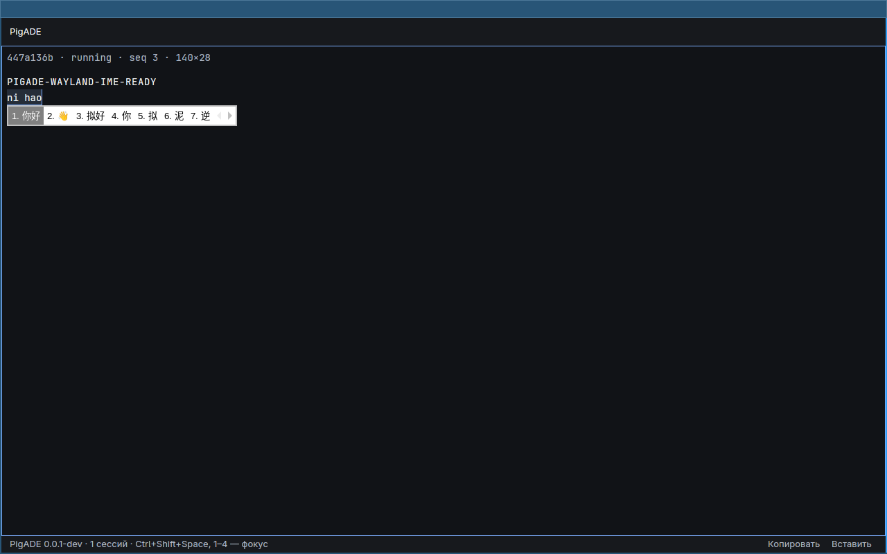
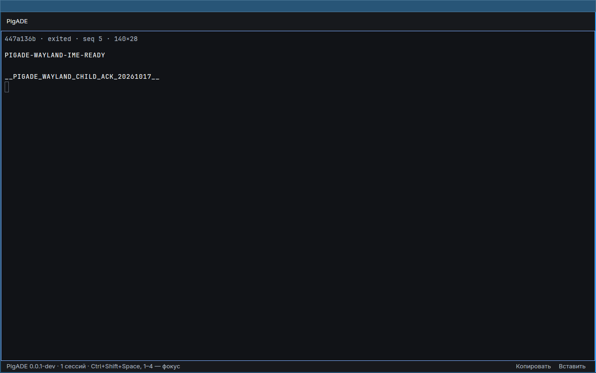

# Private Wayland text-input-v3 / Fcitx test

Status: **the signed test SDK is prepared, and one isolated runtime fixture
passed** (2026-10-17). SDK preparation remains a no-compositor/no-input action;
the separate runtime run used a private Sway/Pixman server and a fixed Pinyin
fixture. This is evidence for one pinned host-ABI setup, not product acceptance.
See [the run report](../reports/wayland-ime-20261017.md) and curated
[summary](../../crates/app/evidence/ime-wayland-20261017/summary.json).

## Protocol choice and prepared payload

Use Sway 1.12 with wlroots 0.20.2: its source creates both the input-method-v2
and text-input-v3 managers. GPUI at pinned revision
`322cd509dcccaee1f6bc44725d270598ae8171ad` uses `zwp_text_input_v3`. Fcitx
5.1.23 provides the Wayland frontend and input-method-v2 side. Weston 15.0.1
is not a replacement for this test; Fcitx's Wayland guide describes its
text-input-v1/input-method-v1 pairing and identifies Sway for v3/v2.

The pinned Arch payloads are downloaded and signature-verified by
`scripts/prepare-wayland-ime-sdk.py`. The preparer writes only
`/tmp/pigade-wayland-ime-sdk-20261017`; it does not launch a compositor, Fcitx,
the application, or send input. It reuses signed Fcitx core/Pinyin assets from
the separate X11 SDK and verifies the extracted payload inventory against the
signed package archives. The Wayland SDK manifest records the 181 selected
Wayland files; the X11/Fcitx SDK has 1,232 verified files. The runtime maps
these roots read-only and uses host `/usr` for ABI dependencies, so this is not
a portable or hermetic sysroot.

Package pins, signers, licenses and archive hashes remain recorded in the SDK
manifest at `/tmp/pigade-wayland-ime-sdk-20261017/evidence/manifest.json`.
The exact current manifest hash from the successful run is
`a22c5a441c07f9c29b242d3158b656473dc9b0fd65fbed428360c54f4d5a17e2`.
The runtime also validates the existing X11/Fcitx and software-renderer
manifests before opening bwrap. It sets `XKB_CONFIG_ROOT` to the verified
signed X11/Fcitx SDK's `usr/share/xkeyboard-config-2` files and preflights the
fixed evdev keycodes, US symbols, and rules.

## Checked dependency versions and licenses

These are test payloads, not bundled product runtime dependencies. Exact archive
hashes/signers are enforced by the committed preparer and the signed manifest.

| Payload | Pinned version | License metadata |
| --- | --- | --- |
| Sway |1:1.12-4|MIT|
| wlroots |0.20.2-1|MIT|
| libliftoff |0.5.0-1|MIT|
| wayland-protocols |1.49-1|MIT|
| Fcitx core / Wayland frontend |5.1.23-1|LGPL-2.1-or-later; Unicode-DFS-2016|
| wayland-utils |1.3.0-1|MIT|
| wtype (prepared, not runtime keyboard helper) |0.4-2|MIT|
| grim |1.5.0-2|MIT|

Pinyin/chineseaddons remains GPL-2.0-or-later test-only payload from the signed
X11 SDK. The persistent keyboard helper is first-party C; its exact wtype-v0.4
protocol XML and upstream MIT notice are retained in scripts/wayland-ime-input.

## Reproduction commands

Inspect the non-mutating plans and prepare/test the signed SDK:

```sh
python3 scripts/prepare-wayland-ime-sdk.py --plan
python3 scripts/prepare-wayland-ime-sdk.py
python3 scripts/test_prepare_wayland_ime_sdk.py
python3 scripts/isolated-ime-wayland.py
python3 -m unittest scripts.test_isolated_ime_wayland -v
```

The harness's only execution mode is explicit `--run`. Use the exact release
app and session-host artifacts whose SHA-256 values are recorded below, and a
new private output path outside the repository:

```sh
ime_run_path="/home/afterburner/.local/state/pigade/ime-wayland-rerun-$(date -u +%Y%m%dT%H%M%SZ)-$$"
python3 scripts/isolated-ime-wayland.py --run \
  --app crates/app/target/release/pigade-app \
  --host target/release/pigade-session-host \
  --wayland-sdk /tmp/pigade-wayland-ime-sdk-20261017 \
  --x11-sdk /tmp/pigade-x11-ime-sdk-20261017 \
  --platform-sdk /tmp/pigade-platform-sdk \
  --output "$ime_run_path"
```

The output path must not already exist and must remain outside the repository.
The successful invocation is recorded at
`/home/afterburner/.local/state/pigade/iw-v3-persist-1017`; the curated copy
contains only summary metadata and the two screenshots. The saved run proves
that the app SHA-256 was `484b1eacdb8df844c422e298470a3bd7736dc7907e8b7af79942cf0681bb9669`
and the host SHA-256 was
`610efac4b817116ed761217a9738485c2b499bf6fb05a30ebce7cb6dbf7e4791`.
Neither release binary currently at the command paths matches the saved run.
At report validation, `crates/app/target/release/pigade-app` hashes to
`3eba79d2d9b84d14e280a6a1de8ac07409432f49db6c61cedcd8a13e747af39a`, and
`target/release/pigade-session-host` hashes to
`477d5f81375b38a15aae177144f8e3515017649100bf0424dfd89d4646b8d4d2`. A new
run with those current files is new evidence, not an exact replay. Check the
run summary hashes before describing a rerun as identical.

## Runtime result

The successful fixture ran under fresh user, mount, PID, IPC and network
namespaces. It exposed only loopback networking and a private `/home`, `/tmp`,
`/run`, and `/dev`; host display, bus, GPU and input endpoints were absent. The
parent verified the inner Python process' namespace identities from kernel
namespace handles before releasing its one-shot startup gate. The private
Wayland socket peer and Sway IPC peer matched the exact owned Sway process
(boot ID, PID, start time and socket inode). The private D-Bus daemon had
activation disabled. A single visible app window matched the PigADE PID and
was focused only through the verified private Sway IPC connection.

Sway advertised `zwp_text_input_manager_v3`,
`zwp_input_method_manager_v2`, and `zwp_virtual_keyboard_manager_v1`. Private
Fcitx reported Pinyin active. One persistent, test-only
`zwp_virtual_keyboard_v1` object sent the fixed physical US sequence `n i h a
o`, then Space. The helper accepts no arbitrary text or key arguments and
rejects duplicate/out-of-order compose/commit commands. Before Space the PTY
had received zero bytes; afterward the child independently acknowledged the
exact six UTF-8 bytes for `你好`, with zero extras. The child ACK was not based
on terminal echo.

The root visually reviewed the retained captures: the preedit showed the
romanized input and `你好` candidate, and the committed view showed the cleared
candidate popup plus child ACK. The screenshot contents were not machine
classified. The captured `preedit.png` SHA-256 is
`d7bf1353aeda092746e24ac38a8b6c2cd276eafdd6e210d31358bce4cf5a0e02`; the
committed capture SHA-256 is
`8db7271fde6e5b0557c3ae17240bfe6c641b5ec96c8e80e3cd7bdb15d6ee771c`.





The source/evidence identities for the successful run are:

| Artifact | SHA-256 |
| --- | --- |
| Isolated harness source | `a0c0f834bcf4ce551500391f7bae750971a196b6b6ec4dfdecc31d658002216c` |
| App release binary | `484b1eacdb8df844c422e298470a3bd7736dc7907e8b7af79942cf0681bb9669` |
| Session-host binary used | `610efac4b817116ed761217a9738485c2b499bf6fb05a30ebce7cb6dbf7e4791` |
| Persistent virtual-keyboard helper | `916e71bf2da35bacaf2bb4f385b50a9ae080e3132542e174745b315cbac5d426` |
| Helper C source | `c18a2b89da86b03daa7cfaaaca7fa01851089a4afec5203fa14a3b03e8de08fa` |
| Wayland SDK manifest | `a22c5a441c07f9c29b242d3158b656473dc9b0fd65fbed428360c54f4d5a17e2` |
| X11/Fcitx SDK manifest | `7a3198632791a7fea235e3d2604ee21c838a5df823588fe2581cf9e506976d6a` |
| Renderer SDK manifest | `a7426b082a9224227392f964e9da3238066e9c2887201501e69a3fa5f59caa59` |

## Failed closed attempts

Earlier private attempts are summarized in
[`earlier-attempts.json`](../../crates/app/evidence/ime-wayland-20261017/earlier-attempts.json).
They were retained outside Git and failed before any fixture input: an
incorrect font-verifier import, bwrap metadata/namespace identity mismatches,
and a private Fcitx run that could not confirm Pinyin active. The final run
fixed the font verifier and attested the actual inner process using kernel
namespace handles; the persistent virtual keyboard created a seat before app
startup and remained alive through composition and commit. Failed attempts
were not retried automatically and their private state was preserved.

## Limits and follow-up

This proves one fixed Sway 1.12/Pixman + Fcitx 5.1.23 Pinyin fixture on this
host ABI. It does not establish behavior for other Wayland compositors, input
methods, locales, or operating systems; GPU/vulkan rendering; fractional
scaling; clipboard; or popup placement beyond the reviewed capture. It does
not close the app's native IME session-generation/reset barrier: stale
preedit/commit callbacks across target changes still require a separate
correctness gate. The helper is test-only and not a product input path.

## Primary references

- [Sway 1.12 `server.c`](https://github.com/swaywm/sway/blob/1.12/sway/server.c),
  where the input-method-v2 and text-input-v3 managers are created.
- [Sway 1.12 `text_input.c`](https://github.com/swaywm/sway/blob/1.12/sway/input/text_input.c),
  including the input-method relay and popup-surface handling.
- [Arch Sway 1:1.12-4 package record](https://archlinux.org/packages/extra/x86_64/sway/)
  and [wlroots0.20 0.20.2-1 package record](https://archlinux.org/packages/extra/x86_64/wlroots0.20/).
- [Arch wayland-protocols 1.49-1 package record](https://archlinux.org/packages/extra/any/wayland-protocols/).
- [Fcitx 5 on Wayland](https://fcitx-im.org/wiki/Using_Fcitx_5_on_Wayland/en),
  for the compositor/application protocol pairing and Weston limitation. Its
  older Sway popup note is not used as evidence for the tested version.
- [Pinned GPUI Wayland client source](https://github.com/zed-industries/zed/tree/322cd509dcccaee1f6bc44725d270598ae8171ad/crates/gpui_linux/src/linux/wayland),
  for the application's text-input-v3 implementation.
